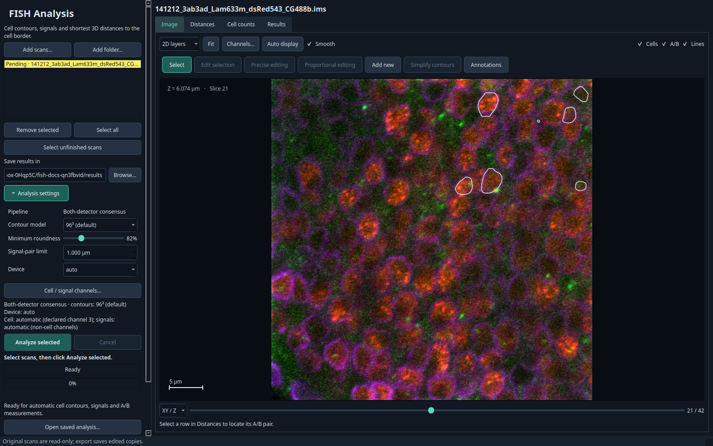

# FISH Analysis

Desktop analysis of Imaris microscopy scans: detect cells and fluorescent signals,
review and edit their annotations, and measure physical 3D cell volumes,
signal-to-border distances and distances between nearby signals of different colors.
Original scans and annotations are opened read-only.

**[Download v0.11.0](https://github.com/Rokoel/fish-analysis/releases/tag/v0.11.0)** ·
**[Analysis guide](docs/fish-analysis.md)** · **[Documentation](docs/README.md)** ·
**[Models and evaluation](docs/models.md)**

*Both-detector consensus with a choice of bundled contour models.*

## Why this instead of Imaris?

Imaris can perform similar segmentation and measurement tasks, but its ML surface
segmentation relies on interactive foreground/background training and tuning.
FISH Analysis uses fixed models trained for this project's microscopy acquisitions,
so routine analysis requires no brush-stroke training or per-scan segmentation
tuning. It is free, reproducible, and can export results back to Imaris for review.

## Get started

Download the Windows x64 **EXE** or Linux x64 **AppImage** from the release.
Windows uses CPU inference. Linux supports CPU or NVIDIA GPU inference and installs
its verified neural runtime on first launch. See [installation and runtime details](docs/releasing.md).

1. Add an IMS scan, an IMX scene with its image, or a folder of scans.
2. Check the cell channel and select the signal channels.
3. Choose an output folder and, under **Analysis settings**, a contour model:
   **96³** (default) or **64³ — longer-trained**. Run **Both-detector consensus**.
4. Review cells, signals and measurements. Export creates exactly two files:
   a standalone annotated **IMS** image and an **Excel workbook**.

Both-detector consensus is the only pipeline. Both detectors use the selected
contour U-Net, followed by the signal-center U-Net. Roundness defaults to **82%**, with a selectable
range of **75–100%**. A higher value rejects irregular cells; it leaves surviving
contours unchanged.

## Newly bundled contour models

The [training and comparison report](reports/contour-training-20261104/README.md)
records five completed fine-tuning runs, including two seeds for each plain crop
size. Each run added 20 epochs. Both bundled checkpoints selected seed 42, epoch 19
using validation data. On **508 complete manual test cells**:

| Contour checkpoint | Surface error ↓ | Volume MAPE ↓ | Mean IoU ↑ |
| --- | ---: | ---: | ---: |
| Previous selected 64³ | 0.1130 µm | 4.52% | 0.8619 |
| Newly bundled 64³ | **0.1080 µm** | **4.18%** | **0.8665** |
| Newly bundled 96³ (default) | 0.1096 µm | 4.26% | 0.8652 |

Both new models improved over the previous checkpoint and matched all 508 targets
at IoU ≥0.5. Longer-trained 64³ scored slightly better on this cohort; the direct
96³–64³ acquisition-bootstrap intervals include zero. 96³ is the chosen default,
not a claim of proven superiority. It samples the same physical crop more finely
and uses more computation.

This test isolates contour drawing with manual boxes/seeds; it does not measure
full-consensus recall, field precision or signal-distance accuracy. The folds were
used previously, so results remain exploratory. The [historical roundness report](reports/consensus-roundness-20261028/README.md)
used the retired contour checkpoint and does not describe the new models.

## Review, edit and measure

- Imported annotations and annotations created in the current run have independent
  visibility controls. UUIDs and run provenance support repeated import/export and
  reanalysis without relying on object names.
- Select a cell or signal to reveal its nearest visible 2D section. Display
  interpolation starts enabled, contrast adapts to sparse fluorescence, and zoom
  stays anchored at high magnification.
- Precise and proportional editing, layered contours, selection movement,
  simplification with per-cell skip reporting, and undo support contour review.
  Edits recalculate volumes and affected distances. Deleting a cell also removes
  its associated signals.
- Different-channel signals are paired closest-first within each cell and time
  point. A configurable physical cutoff, initially **1 µm**, excludes distant pairs.
  Pair distances are exported in the IMS and the workbook's **Signal pairs** sheet.

The editing sidebar starts hidden. Export preserves pre-existing names and dates;
new annotations receive creation timestamps. Excel includes cell volumes and
signal-to-border distances in **Measurements**, plus signal pairs when present.
See [editing and measurements](docs/fish-analysis.md) and
[Imaris compatibility](docs/imaris-export.md).

## Source installation and development

Use Python 3.12 and the [source installation instructions](docs/fish-analysis.md#installation),
then launch `./run-analysis.sh` on Linux or `fish-analysis` in the activated environment.
The repository includes the
six component bundles: two detectors, two selectable contour U-Nets and two
selectable signal-center U-Nets, supporting the single consensus pipeline.

`python -m fish_viewer` opens the general Viewer and developer training tools.
`python -m fish_viewer.annotation --audit /absolute/path/audit.json --output /absolute/path/annotations`
opens the training annotator. Future training and evaluation require explicit data
paths; historical training metadata and painted annotations are no longer bundled.
The combined historical report stays local and is excluded from Git and releases;
the new contour training/comparison report is included in the release. The older
roundness report retains its historical model identity. Retired StarDist 2D
results remain in the previous release history.

Run core tests with `python -m pytest -p no:cacheprovider -m "not neural and not gui and not integration"`.
GUI tests require Qt/VTK or `QT_QPA_PLATFORM=offscreen`; neural tests require the
TensorFlow/StarDist and configured PyTorch runtimes. See [architecture](docs/architecture.md),
[training](docs/neural-training.md) and [release checks](docs/releasing.md).
