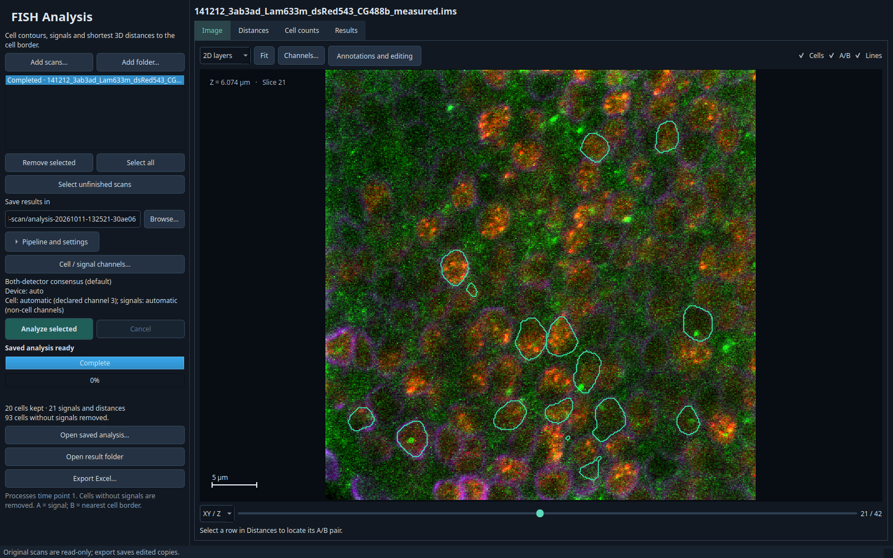
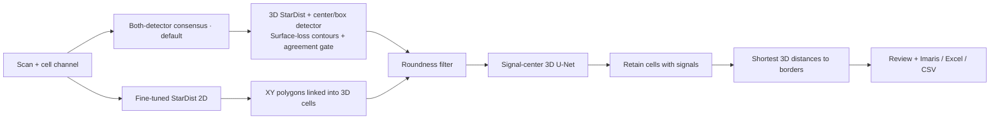

# FISH Analysis

**[Download a release](https://github.com/Rokoel/fish-analysis/releases/latest)** ·
**[Analysis guide](docs/fish-analysis.md)** · **[Documentation](docs/README.md)** ·
**[Models and evidence](docs/models.md)**


*A completed both-detector consensus analysis, opened in the running app*

FISH Analysis helps researchers analyze Imaris scans by automating cell contouring,
signal detection, and shortest 3D distances from signals to cell surfaces.
It supports human judgment, with results available for review and correction.

### Why a separate tool?

Imaris can perform many of the same individual operations, including cell/surface
segmentation, spot detection and distance measurements. FISH Analysis is intended
for a different workflow: its bundled models are trained specifically for the
microscopy acquisitions used by the project and can then be applied without
interactive foreground/background painting or per-scan segmentation training.

For routine analysis, the operator checks the channel roles and starts the
pipeline. The same fixed models and thresholds can be applied across scans from
different acquisition groups; manual correction is available when needed, but it
is not part of the automatic inference procedure.

The project also keeps the analysis inspectable and reproducible: model
checkpoints, thresholds, processing code and evaluation reports are versioned
together. Results can still be exported as Imaris-compatible scenes, so the tool
can be used as a specialized automatic analysis stage rather than as a replacement
for Imaris visualization and downstream inspection.

The goal is therefore not to reproduce every Imaris feature or claim universal
superiority over interactive segmentation. It is to provide a free, repeatable
pipeline for this specific FISH workflow with no interactive segmentation tuning
required for each analyzed scan.

- **Analysis** is the main app, it processes scans, supports result editing, and exports Imaris, Excel and CSV files.
- **Viewer** displays scans and annotations in 2D/3D and provides model inference and training tools.
- **Training Annotator** collects painted cell-border examples for training.


## Get started

### Standalone application

Download the Windows EXE or Linux AppImage from the release page. Windows includes
a CPU runtime. Linux downloads and verifies its neural runtime on first launch;
allow about 11 GB free during setup and about 8 GB for the retained runtime.
Later launches reuse the installed runtime. See [installation and releases](docs/releasing.md).
For offline setup, download both matching `.runtime.part*` files beside the
AppImage and keep their original filenames; the app detects them automatically.

### Run from source

Use Python 3.12. Setup installs the GUI/TensorFlow environment and the separate
PyTorch environment used by the default signal detector.

| | Linux | Windows |
|---|---|---|
| First-time setup | `./setup-analysis.sh` | `setup-analysis.bat` |
| Analyze scans | `./run-analysis.sh` | `run-analysis.bat` |
| Explore scans and train models | `./run-viewer.sh FISH` | `run-viewer.bat FISH` |
| Paint training annotations | `./run-annotator.sh` | `run-annotator.bat` |

The existing local environments can be reused. Linux GPU setup for PyTorch is
separate from the default CPU installation; see [signal runtime setup](docs/signal-centers.md).
The desktop needs a working OpenGL driver. See [viewer setup and controls](docs/viewer.md)
for a minimal installation without neural dependencies.

## Analyze a scan

1. Add scans or a folder and select the scans to process.
2. Check the cell and signal channel roles; fluorescence channel order varies by scan.
3. Choose an output folder and review **Pipeline and settings**.
4. Click **Analyze selected**, then inspect **Image**, **Distances**, **Cell counts** and **Results**.
5. Keep exported `.imx` and `.ims` files together; open the `.imx` in Imaris.

The default uses **both-detector consensus** and the **signal-center 3D U-Net**.
Minimum roundness is 0.72; setting it to zero disables shape rejection.
Other fixed presets and manual editing are described in the [Analysis guide](docs/fish-analysis.md).



Each stage runs in a separate worker process. Results are saved separately from
source data; cancellation preserves completed runs.

### Review contours and measurements

| Inspect a signal and its nearest border | Review manual and program measurements |
|---|---|
|  |  |

Select a measurement to locate its A–B segment in the image. Open
**Annotations and editing** to inspect contours or adjust points; edited geometry,
volumes, distances and exports stay synchronized. Manual annotations and automatic
results can be shown separately. See the [review and export guide](docs/fish-analysis.md).

## Models and measured limits

All current checkpoints are in [`models/`](models/); their evaluation reports,
plots and tables are in [`reports/`](reports/). Start with the [model inventory](docs/models.md)
and [evaluation guide](docs/evaluation.md).


*Measurement evidence for the two cell presets on 71 historical test scans,
with the signal-center U-Net and roundness gate of 0.72. Whiskers show 95%
acquisition-bootstrap intervals. Matched cells/signals and channel protocols differ
between reports, so these averages are not a paired ranking or whole-field detection
accuracy. Sources: [correct-channel consensus](reports/consensus-correct-channels/README.md)
and [fine-tuned StarDist 2D](reports/stardist2d/distances/README.md).*

Incomplete manual annotations leave many detected cells unscored. Review real
contours and channel choices before interpreting detection totals as accuracy.
Experimental pipelines retain their own documented evaluation scopes.

## Training data and repository layout

Original scans, annotation crops, checkpoints and bundled reports are preserved.
Historical runs, generated training arrays and build outputs have been removed.
Training caches must be rebuilt before retraining; small reconstruction metadata
is retained locally in `training_metadata/`.

| Folder | Purpose |
|---|---|
| `fish_viewer/` | Analysis, viewer, annotator and worker code |
| `models/` | Bundled inference checkpoints and manifests |
| `reports/` | Release evaluation evidence and plots |
| `docs/` | Usage, model, training and release guides |
| `scripts/`, `tests/`, `packaging/` | Research/build tools, checks and release definitions |
| `FISH/`, `training_annotations/` | Local original scans and annotation data; excluded from Git |
| `training_metadata/` | Local archived splits, recipes, indexes and training provenance |
| `.venv/`, `.venv-spots/`, `.venv-freeze/` | Main, signal and packaging environments; excluded from Git |

See [training data and rebuilding caches](docs/training-data.md). Source installations
use the two working environments for inference as well as training.

## Development

```bash
.venv/bin/python -m pip install -e '.[test]'
.venv/bin/python -m pytest -q
.venv/bin/python scripts/verify_release.py --require-latest-models --with-direct-signals
```

The optional signal suite uses `.venv-spots/`; tests requiring unavailable local
data or optional runtimes skip. [Architecture](docs/architecture.md) explains the
worker boundaries. [Releasing](docs/releasing.md) covers packaging and verification.

## Attribution

The fine-tuned StarDist 2D model derives from the official `2D_versatile_fluo`
checkpoint. Its BSD-3-Clause licence is in
[`PRETRAINED-LICENSE.txt`](models/cells-stardist2d/PRETRAINED-LICENSE.txt).
Please cite Schmidt, Weigert, Broaddus and Myers, *Cell Detection with Star-convex
Polygons*, MICCAI 2018, [DOI](https://doi.org/10.1007/978-3-030-00934-2_30).
