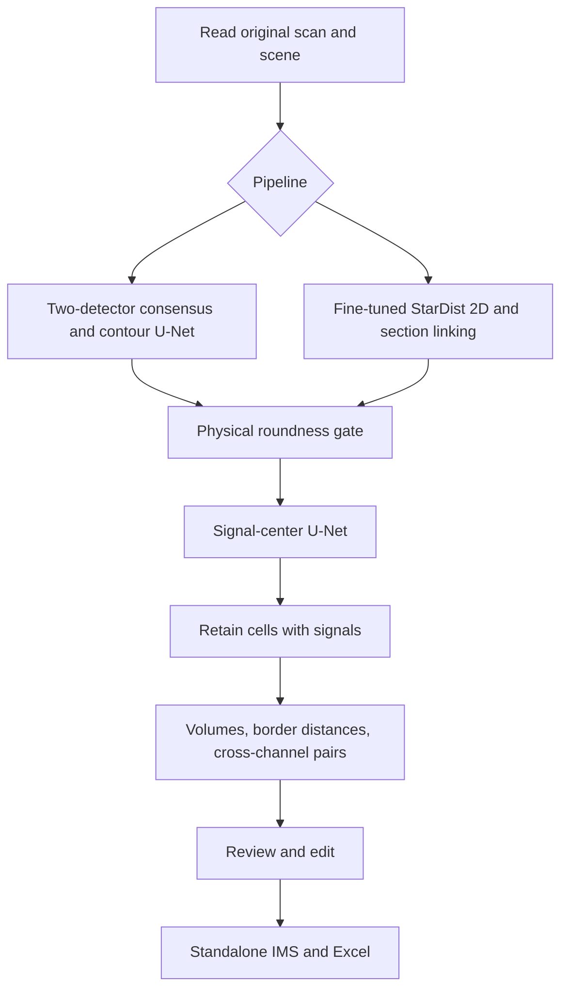

# Architecture

[Documentation](README.md)

PySide6 owns the UI; PyVista/VTK renders 3D annotations and volumes. TensorFlow cell
workers and the PyTorch signal worker run in separate processes. JSON progress
on stdout and diagnostics on stderr keep neural runtimes outside the GUI process.
Cancellation preserves completed outputs.

| Module | Responsibility |
| --- | --- |
| `reader`, `scenes`, `embedded`, `annotation_state` | Original pixels/calibration, native scenes, identities and provenance |
| `analysis` | Two-pipeline orchestration, selection, contour editing and current-run ownership |
| `neural`, `proposals`, `refinement` | StarDist, center/box detection and supported contour network |
| `spots`, `signals` | U-Net centers, sparse supervision, physical suppression and saved-result compatibility |
| `pipeline` | Shared preparation, mask geometry, evaluation and prediction archives |
| `workflow` | Filtering, mesh measurements, pairing, Excel and native IMS output |
| `evaluation` | Reusable manual-reference and error-statistics helpers |
| `annotation`, `training_gui` | Explicit-data annotation and developer training presentation |
| `worker_runtime`, `runtime_cache`, `standalone` | Process environment, cancellation and packaged runtime dispatch |

Raw image data are read-only. Annotation edits operate on in-memory objects;
export modifies a new image copy. UUIDs identify annotations, and an active run ID
rather than object names distinguishes new detections. Imported annotations remain
pre-existing, including previously exported app results.
