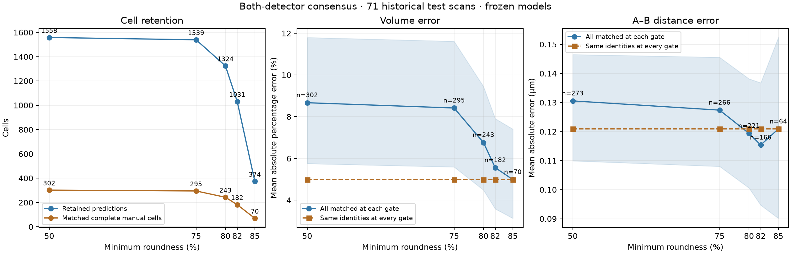

# Consensus roundness sweep

All 71 historical test scans; frozen models and corrected stain-aware channels. Both detectors regenerated once; unchanged per-cell signal inference reused across rejection gates. Manual cells matched one-to-one at IoU >=0.5; signal centers within 0.6 um in the same cell/channel. Volume and distance errors exclude cut manual cells; distances use original manual A-B lines. All outliers included. Sparse manual labels do not establish whole-field precision. This threshold sweep on a historically reused test fold is exploratory, not an independent threshold-selection validation.

| Roundness | Cells before signal filtering | Retained cells | Matched complete manual cells | Volume MAPE | Distance MAE (µm) | Distance pairs |
|---|---:|---:|---:|---:|---:|---:|
| 50% | 4491 | 1558 | 302/508 | 8.67% | 0.131 | 273 |
| 75% | 4430 | 1539 | 295/508 | 8.42% | 0.127 | 266 |
| 80% | 3884 | 1324 | 243/508 | 6.76% | 0.119 | 221 |
| 82% | 3101 | 1031 | 182/508 | 5.56% | 0.115 | 166 |
| 85% | 1090 | 374 | 70/508 | 4.99% | 0.121 | 64 |

Model/input hashes, per-scan counts and all individual measurement pairs are retained in [summary.json](summary.json), [per-scan.csv](per-scan.csv), [volumes.csv](volumes.csv) and [distances.csv](distances.csv).
Both measurement CSVs flag cut cells explicitly; exclude rows with `cut=True` to reproduce the primary metrics.

A higher gate does not reshape a retained cell or change its per-cell signal prediction. Changes in aggregate error therefore primarily reflect which cells/signals survive. The JSON also reports volume error on the manual-cell cohort common to all thresholds.

## Error tails for a precision-first workflow

These are errors among matched complete manual cells/signals, with all outliers retained.

| Roundness | 95th-percentile volume error | 95th-percentile distance error (µm) |
|---|---:|---:|
| 50% | 30.17% | 0.360 |
| 75% | 28.08% | 0.359 |
| 80% | 21.62% | 0.357 |
| 82% | 14.90% | 0.359 |
| 85% | 13.12% | 0.339 |

## Contour overlap with complete manual cells

| Roundness | Median IoU among matches | Matches at IoU ≥0.75 | Matches at IoU ≥0.90 |
|---|---:|---:|---:|
| 50% | 0.870 | 265 | 49 |
| 75% | 0.872 | 262 | 49 |
| 80% | 0.877 | 226 | 48 |
| 82% | 0.880 | 175 | 42 |
| 85% | 0.885 | 69 | 20 |

Common cohorts across all five gates: 70 complete manual cells and 64 matched manual signals.

The common-cohort lines compare the same manual identities across gates. Shaded intervals show 95% acquisition-bootstrap intervals; changing matched populations must be considered when comparing aggregate errors.

## Automatic selection: proposed next step

Calibrate on acquisition-separated validation data, using a specified quality target (for example, an upper bound on volume error or on the fraction of inaccurate contours). Choose the lowest roundness gate meeting that target with adequate confidence; this retains the most cells within the requested quality limit. Mean error alone does not control occasional large contour failures.

For adaptation to new scans, train a contour-quality estimator using predicted masks and raw membrane crops, with roundness, boundary support and detector agreement as inputs. Predicting mask quality separately from detection confidence has precedent in [Mask Scoring R-CNN](https://arxiv.org/abs/1903.00241); applying it here would require training and validation for these 3D microscopy data. Fully reviewed regions, including rejected and false-positive candidates, are needed to calibrate a reliable acceptance rate. The existing sparse manual cells can assess matched-cell geometry, but cannot label every unmatched prediction as wrong.

Keep the final threshold-selection calibration separate from this exploratory test sweep. The current app still uses its manual minimum-roundness setting; no Auto selector or new quality model is introduced by this benchmark.
