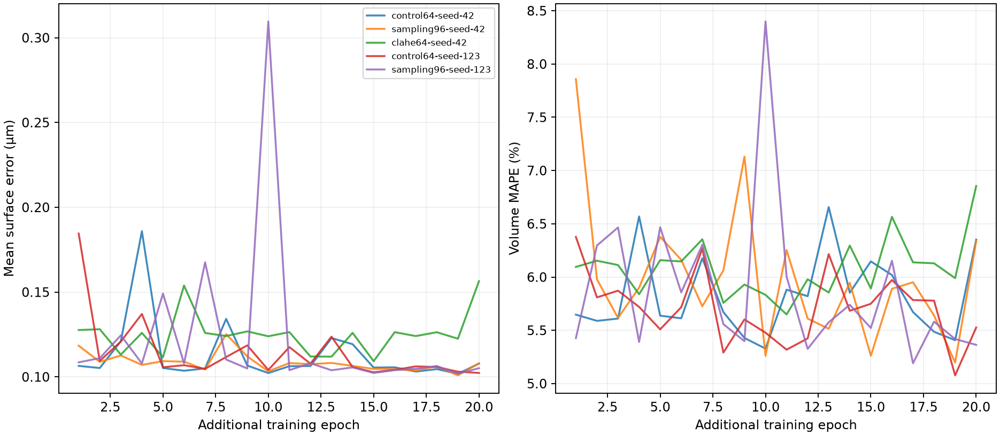
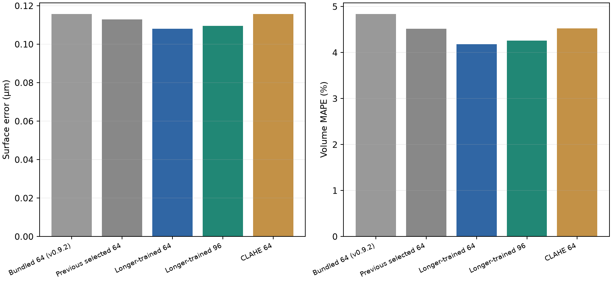

# Contour U-Net training and comparison — v0.10.0

[Project](../../README.md) · [Bundled models](../../docs/models.md)

The release bundles newly fine-tuned **96³** and **64³** seeded contour U-Nets.
Both-detector consensus uses the chosen U-Net for both detector branches. 96³ is
the user-selected default; longer-trained 64³ remains selectable in the dropdown.

## Training

| Split | Scans | Complete cells | Acquisition groups |
| --- | ---: | ---: | ---: |
| Training | 215 | 1,493 | 56 |
| Validation | 73 | 574 | 20 |
| Test | 71 | 508 | 19 |

Each recipe continued its previous best checkpoint with a fresh Adam optimizer,
learning rate 0.00005, batch size 1 and float32 computation. Every training cell
was visited each epoch, supplemented by 15% synthetic negative crops. Five runs
completed 20 additional epochs each. Seeds change sample order and augmentation,
not the pretrained starting weights. Interrupted 96³ seed 123 was rerun from its
original checkpoint because optimizer state had not been saved.

The plain 64³ and 96³ recipes retain spatial, brightness and Gaussian-noise
augmentation without the experimental microscopy augmentation. CLAHE 64³ also
uses that microscopy augmentation, so it is not a CLAHE-only ablation. 96³ samples
the same physical box more finely; it does not expand context.

Checkpoint selection minimizes validation surface error on the same calibrated
reference grid, with volume MAPE no worse than that run's initial checkpoint.
Epoch zero is retained if no qualifying epoch improves it. Approach selection
also checks volume MAPE and matched-cell count against the previous selected 64³.
Model choices were frozen before final test scoring.

The user stopped four remaining runs and chose the 96³ approach before test
evaluation. CLAHE seed 123 stopped during epoch 5; its partial results and all
three seed-2026 runs are excluded. The original nine-run plan and explicit
[queue amendment](queue-amendment.json) preserve this change.

| Approach | Seed | Best additional epoch | Validation surface (µm) | Volume MAPE (%) | Mean IoU |
| --- | ---: | ---: | ---: | ---: | ---: |
| Plain 64³ | 42 | 19 | 0.101837 | 5.4073 | 0.870856 |
| Plain 64³ | 123 | 20 | 0.102339 | 5.5263 | 0.870095 |
| Plain 96³ | 42 | 19 | **0.100907** | **5.1972** | **0.871613** |
| Plain 96³ | 123 | 19 | 0.101926 | 5.4181 | 0.870075 |
| CLAHE 64³ | 42 | 15 | 0.109243 | 5.8924 | 0.863511 |

Across the two completed seeds, mean selected validation surface error was
0.102088 µm for 64³ and 0.101417 µm for 96³. Both bundled checkpoints are seed 42,
epoch 19. One CLAHE seed is insufficient to estimate variance across seeds.

## Frozen contour-only test

All candidates are scored on the same 508 complete manual cells, using manual
boxes and interior seeds. Predictions are mapped to a common physical grid.
Empty predictions and IoU <0.5 failures remain in the metrics.

| Checkpoint | Surface error (µm) ↓ | HD95 (µm) ↓ | Volume MAPE (%) ↓ | Mean IoU ↑ | IoU ≥0.5 |
| --- | ---: | ---: | ---: | ---: | ---: |
| Bundled 64³ from v0.9.2 | 0.115675 | 0.366831 | 4.8424 | 0.858709 | 507/508 |
| Previous selected 64³ | 0.112992 | 0.358743 | 4.5213 | 0.861900 | 508/508 |
| **New bundled 64³** | **0.108009** | **0.342786** | **4.1831** | **0.866506** | 508/508 |
| **New bundled 96³ (default)** | 0.109611 | 0.352841 | 4.2615 | 0.865245 | 508/508 |
| Longer-trained CLAHE 64³ | 0.115797 | 0.362978 | 4.5290 | 0.858687 | 508/508 |

The new 96³ reduces surface error by 2.99% versus the previous selected 64³ and
5.24% versus the v0.9.2 bundle. Longer-trained 64³ has slightly better test point
estimates. The acquisition-bootstrap 95% interval for new 96³ minus new 64³ surface
error is **−0.000875 to +0.004432 µm**; its volume-MAPE difference interval is
**−0.1713 to +0.2524 percentage points**. Both include zero. These results do not
establish universal superiority of either crop size. No post-test tuning or change
of the selected default was performed.

## Scope and data

This test isolates contour drawing; it does not measure detector recall, field
precision, full-consensus yield or signal-distance accuracy. Historical folds were
used previously, so results are exploratory rather than prospective validation.
Intervals resample 19 acquisition groups (2,000 draws), not individual cells.
Sparse manual labels do not establish precision of unmatched field detections.
The [historical full-consensus roundness report](../consensus-roundness-20261028/README.md)
used a retired contour checkpoint and different mesh-based surface measurements;
its errors must not be pooled with this voxel-boundary evaluation.

- [Five training histories](training.json) and [per-epoch CSV](epochs.csv).
- [Comparison and bootstrap intervals](comparison.json).
- [All test-cell measurements](test-cells.csv).
- [Direct new 96³ versus new 64³ paired comparison](paired-96-vs-64.json).
- [Original protocol](protocol.json) and [queue amendment](queue-amendment.json).
- [96³ manifest](../../models/contours-96/refinement-model.json),
  [64³ manifest](../../models/contours-64/refinement-model.json), and
  [exact bundled-file hashes](../../models/origins.json).

The release training-comparison archive contains this report and data files.
Original scans and crop caches are not distributed. Retired weights remain in
previous tagged releases rather than being bundled again.
